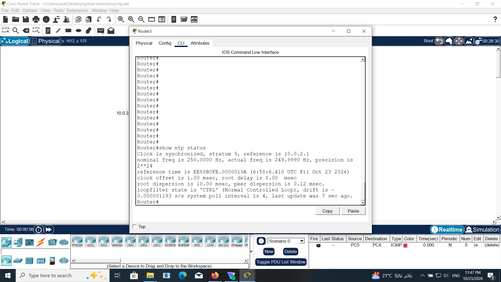

# Lab 09 – NTP Configuration and Time Synchronization

## Overview
This lab demonstrates NTP configuration and time synchronization in a three-router network using Cisco Packet Tracer. OSPF provides IP connectivity between the routers, allowing NTP communication across the network.

## Objectives
- Configure OSPF for IP connectivity.
- Manually set the clock on R1.
- Configure R1 as an NTP master.
- Configure R2 as an NTP client.
- Verify NTP status and associations on R1 and R3.

## Topology


**Devices:** R1, R2, R3  
**Routing Protocol:** OSPF  
**Time Synchronization:** NTP

## Configuration

### R1 – NTP Master

R1's clock was set manually before configuring it as the NTP master.

```cisco
clock set HH:MM:SS DAY MONTH YEAR
ntp master
```

### R2 – NTP Client

R2 was configured to synchronize with R1.

```cisco
ntp server 10.0.1.1
```

## Verification

### 1. Network Topology


### 2. R1 – NTP Associations

```cisco
show ntp associations
```


### 3. R3 – NTP Status

```cisco
show ntp status
```



### 4. R3 – NTP Associations

```cisco
show ntp associations
```


## Key Takeaways
- NTP synchronizes clocks between network devices.
- OSPF provides IP reachability but does not synchronize time.
- `ntp master` configures a router to provide an NTP time reference.
- `ntp server` configures a router to synchronize with an NTP server.
- `show ntp associations` displays NTP association information.
- `show ntp status` displays the router's synchronization state and stratum.

