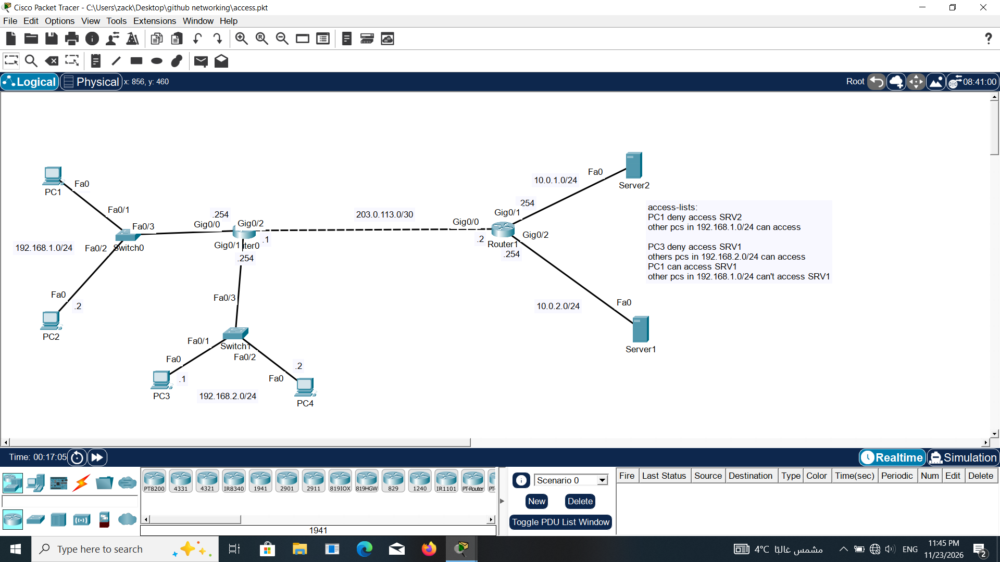
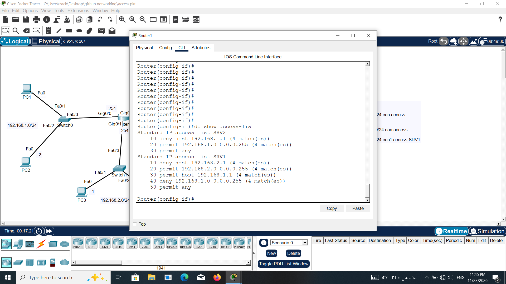
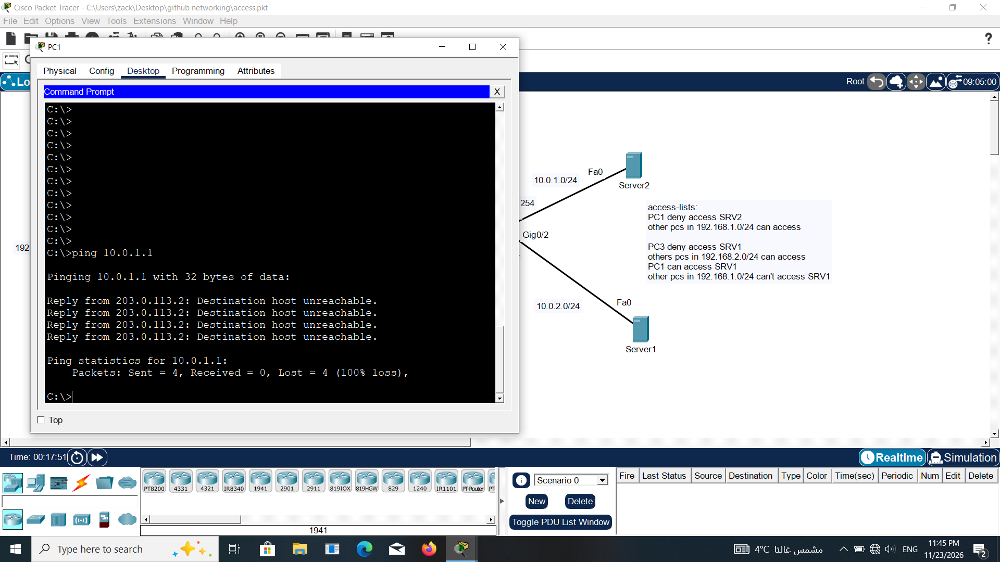
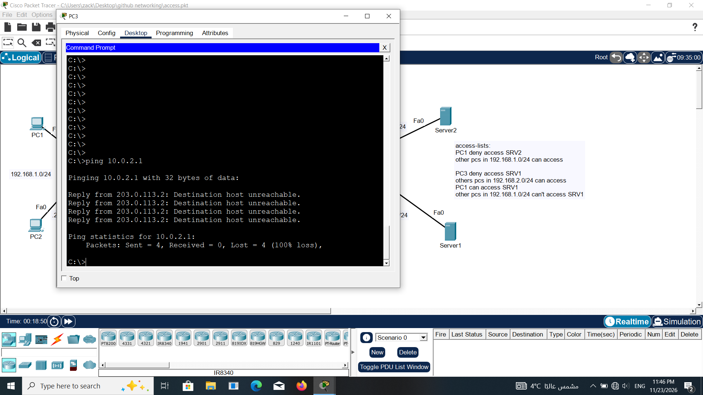
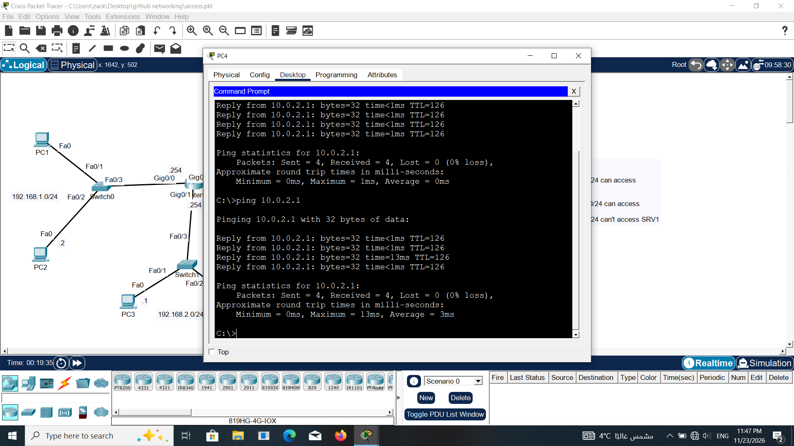

# Standard Named ACLs – Server Access Control

## Lab Overview

This lab demonstrates the implementation of **Standard Named IPv4 Access Control Lists (ACLs)** to control access to two server networks based on source IP addresses.

The topology consists of two routers connected through a point-to-point link. OSPF is configured between both routers using **Area 1**.

The ACLs are configured on Router1 and applied outbound on the interfaces connected to the servers.

## Network Topology

### IP Addressing

| Device | Interface / IP Address | Network |
|---|---|---|
| Router0 | G0/0 – 192.168.1.254 | 192.168.1.0/24 |
| Router0 | G0/1 – 192.168.2.254 | 192.168.2.0/24 |
| Router0 | G0/2 – 203.0.113.1 | 203.0.113.0/30 |
| Router1 | G0/0 – 203.0.113.2 | 203.0.113.0/30 |
| Router1 | G0/1 – 10.0.1.254 | 10.0.1.0/24 |
| Router1 | G0/2 – 10.0.2.254 | 10.0.2.0/24 |
| PC1 | 192.168.1.1 | 192.168.1.0/24 |
| PC2 | 192.168.1.2 | 192.168.1.0/24 |
| PC3 | 192.168.2.1 | 192.168.2.0/24 |
| PC4 | 192.168.2.2 | 192.168.2.0/24 |

## ACL Configuration Requirements

### 1. SRV2 – Server2 Access Control

**Router:** Router1  
**Interface:** GigabitEthernet0/1  
**Direction:** Outbound

Rules:
- Deny PC1 (192.168.1.1) access to Server2.
- Permit other hosts in the 192.168.1.0/24 network to access Server2.

### 2. SRV1 – Server1 Access Control

**Router:** Router1  
**Interface:** GigabitEthernet0/2  
**Direction:** Outbound

Rules:
- Deny PC3 (192.168.2.1) access to Server1.
- Permit other hosts in the 192.168.2.0/24 network to access Server1.
- Permit PC1 (192.168.1.1) to access Server1.
- Deny other hosts in the 192.168.1.0/24 network from accessing Server1.

## Verification and Testing

The following connectivity tests were performed to verify the ACL configurations.

| Source | Destination | Expected Result | Actual Result |
|---|---|---|---|
| PC1 | Server2 | Denied | Denied |
| PC3 | Server1 | Denied | Denied |
| PC4 | Server1 | Allowed | Allowed |

### Verification Screenshots

**1. Router1 – Show Access Lists**

Displays the configured named ACLs and their rules.

**2. PC1 – Access to Server2 Denied**

**3. PC3 – Access to Server1 Denied**

**4. PC4 – Access to Server1 Allowed**

## Key Concepts Practiced

- Standard Named IPv4 ACLs.
- Source IP address filtering.
- Inbound vs. outbound ACL application.
- Applying ACLs to router interfaces.
- ACL processing order.
- Implicit Deny Any.
- Network traffic filtering and verification.
- OSPF routing between multiple networks.

## Project Files

- `access.pkt` – Cisco Packet Tracer project.
- `README.md` – Lab documentation.
- `screenshots/` – Network topology, ACL configuration, and connectivity verification screenshots.

## Important Notes

Standard ACLs filter traffic based on the source IPv4 address only.

Applying the ACLs outbound on the server-facing interfaces allows traffic to be filtered before reaching the respective server networks.

Any traffic that does not match an explicit permit statement is denied by the implicit `deny any` rule at the end of every ACL.
