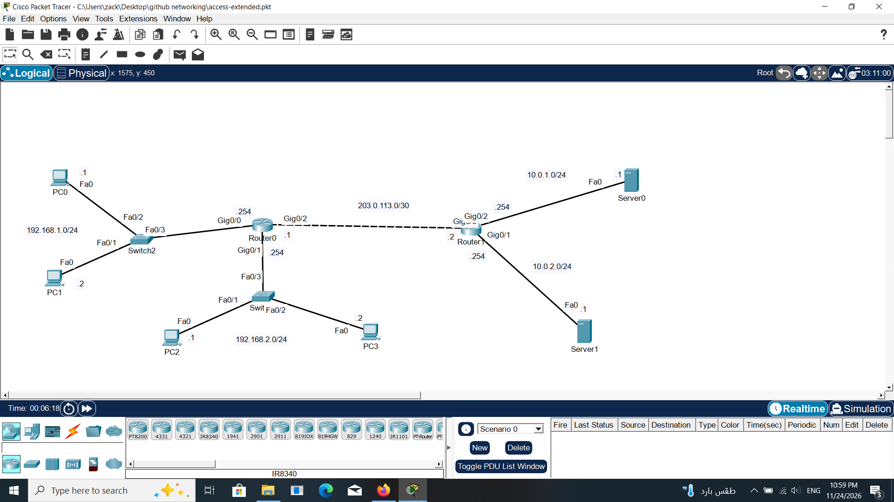
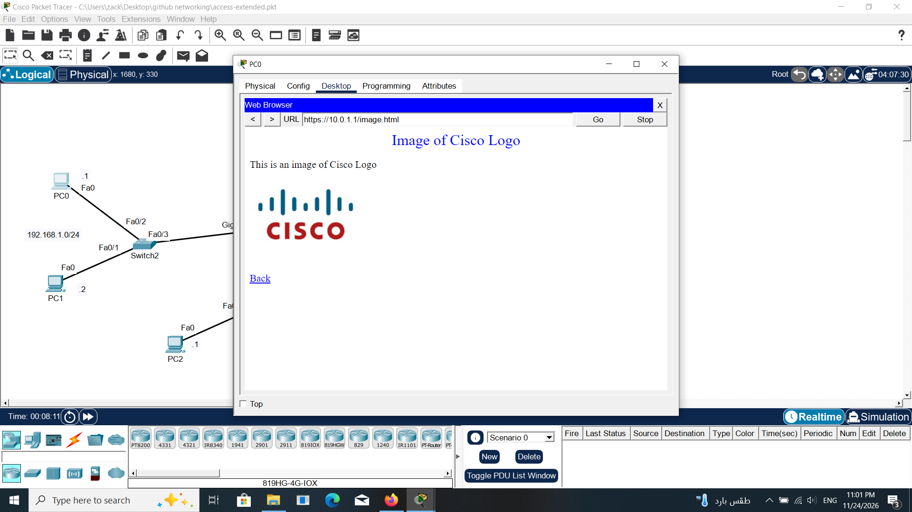
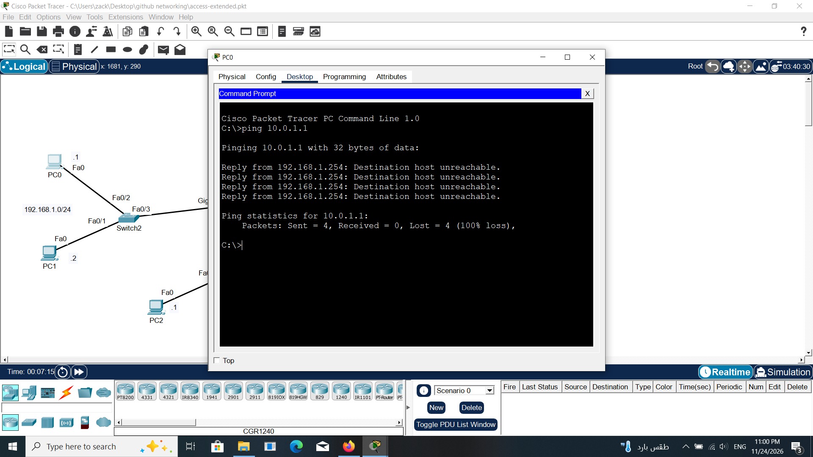
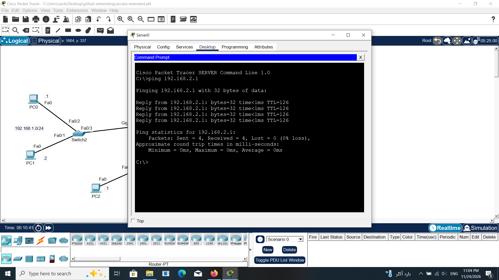
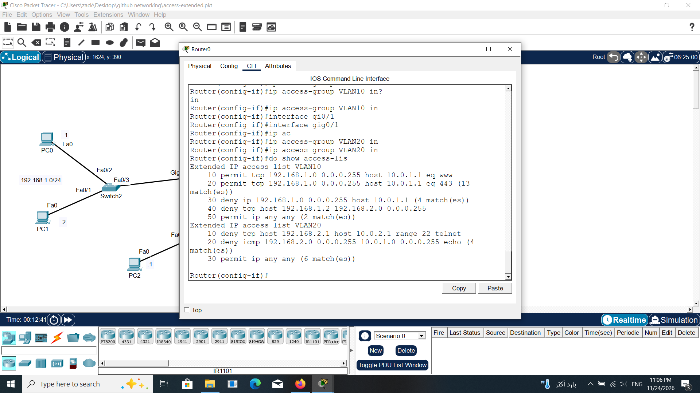

# Extended ACL Lab — Cisco Packet Tracer

A Cisco Packet Tracer lab demonstrating extended named access control lists (ACLs) used to control traffic between two user LANs and two server networks.

## Network Topology

## Addressing Overview

| Network / Device | Address |
|---|---|
| User LAN 1 | `192.168.1.0/24` |
| PC0 | `192.168.1.1` |
| PC1 | `192.168.1.2` |
| User LAN 2 | `192.168.2.0/24` |
| PC2 | `192.168.2.1` |
| PC3 | `192.168.2.2` |
| Server0 Network | `10.0.1.0/24` |
| Server0 | `10.0.1.1` |
| Server1 Network | `10.0.2.0/24` |
| Server1 | `10.0.2.1` |
| Router-to-Router Link | `203.0.113.0/30` |

## ACL Requirements

The lab implements the following four traffic-control requirements:

### Rule 1 — Web-Only Access to Server0

Hosts in `192.168.1.0/24` may access Server0 (`10.0.1.1`) using HTTP (TCP port 80) and HTTPS (TCP port 443) only.

All other traffic from that source subnet to Server0, including ICMP, SSH, Telnet, and FTP, is denied.

### Rule 2 — Block SSH and Telnet from PC2 to Server1

PC2 (`192.168.2.1`) is denied SSH (TCP port 22) and Telnet (TCP port 23) access to Server1 (`10.0.2.1`).

Other hosts in `192.168.2.0/24`, including PC3 (`192.168.2.2`), are not blocked by this host-specific restriction.

### Rule 3 — Block Ping Requests from User LAN 2 to Server0's Network

Hosts in `192.168.2.0/24` cannot initiate ping requests (ICMP echo) to `10.0.1.0/24`.

ICMP echo-replies are permitted, allowing Server0 to initiate a ping toward hosts in `192.168.2.0/24` and receive their replies.

### Rule 4 — Block TCP Connections from PC1 to User LAN 2

PC1 (`192.168.1.2`) is denied all TCP traffic to `192.168.2.0/24`.

PC0 (`192.168.1.1`) and other traffic not matched by this restriction remain permitted, subject to the other ACL rules.

---

## Verification Walkthrough

The following screenshots document the tests and router ACL configuration.

### 1. PC0 Accesses Server0 over HTTPS

PC0 (`192.168.1.1`) connects to Server0 (`10.0.1.1`) using HTTPS (TCP/443).

This demonstrates the permitted web traffic in Rule 1.

### 2. PC2 Cannot Ping Server0

PC2 (`192.168.2.1`) sends an ICMP echo request to Server0 (`10.0.1.1`).

The request is blocked, as required by Rule 3.

### 3. PC0 Cannot Ping Server0

PC0 (`192.168.1.1`) attempts to ping Server0 (`10.0.1.1`).

The ping should fail because Rule 1 permits only HTTP and HTTPS from `192.168.1.0/24` to Server0; ICMP is not permitted.

> **Note:** If this screenshot shows a successful ping, it does not demonstrate the stated Rule 1. Check the ACL entries, their order, and where the ACL is applied.

### 4. Server0 Can Ping PC2 and Receive a Reply

Server0 (`10.0.1.1`) initiates a ping toward PC2 (`192.168.2.1`).

The echo request travels from Server0 to PC2, and the echo reply is allowed back.

This demonstrates the one-way ICMP restriction in Rule 3.

### 5. Router0 ACL Configuration

The `show access-lists` output on Router0 displays the configured ACL entries and their match counters, where available.

---

## Additional Verification Recommended

The screenshots above do not directly demonstrate Rules 2 and 4.

For complete test evidence, consider adding:

- **Rule 2:** From PC2, verify that SSH and Telnet to Server1 are denied. From PC3, verify that the same host-specific restriction does not block those connections.
- **Rule 4:** From PC1, verify that TCP traffic to hosts in `192.168.2.0/24` is denied. From PC0, verify that this host-specific restriction does not block the same test.

Only label these tests as successful after verifying the results in Packet Tracer.
